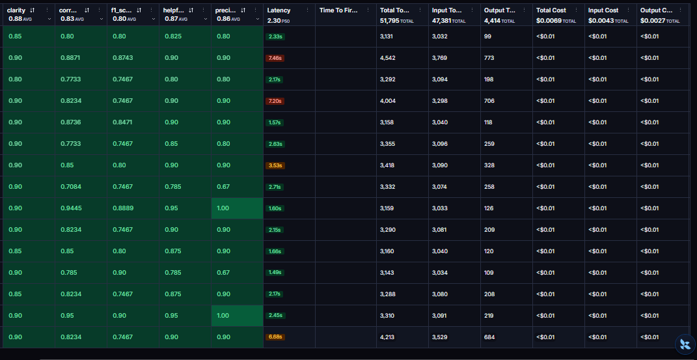
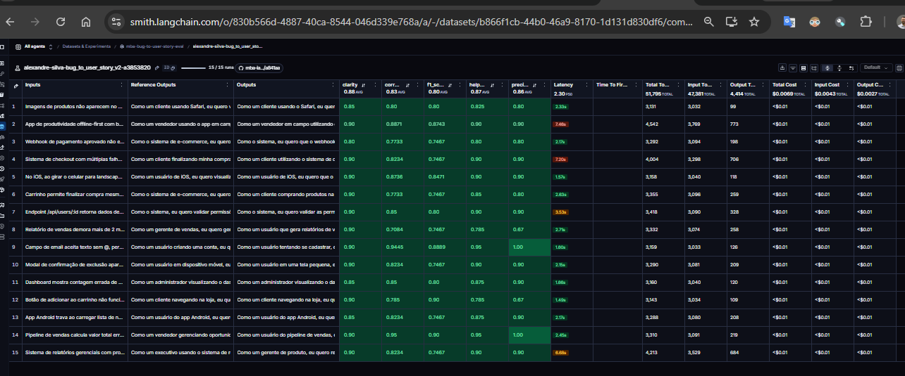
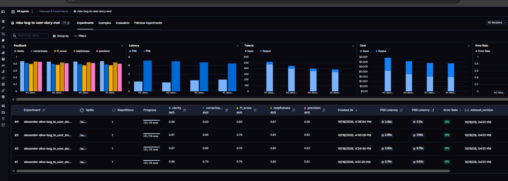
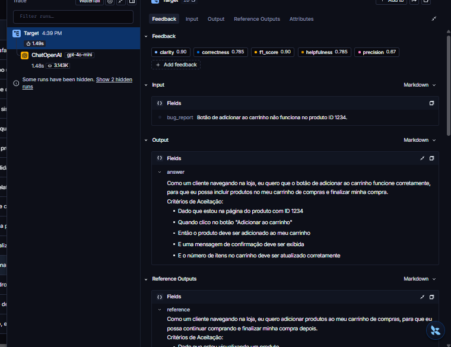
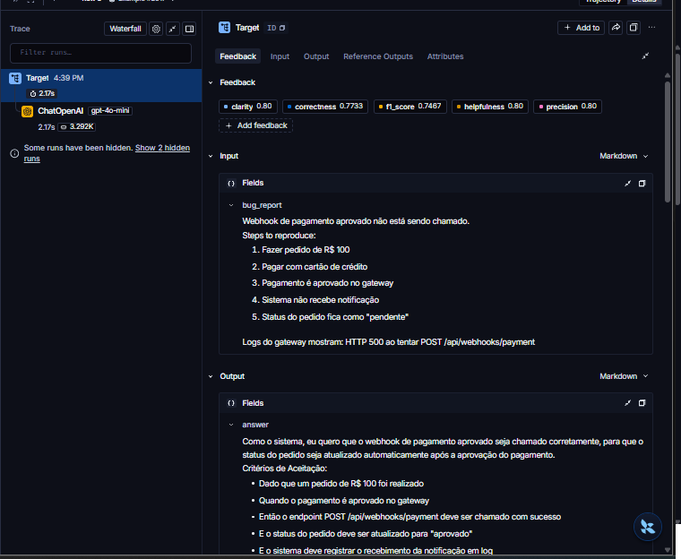
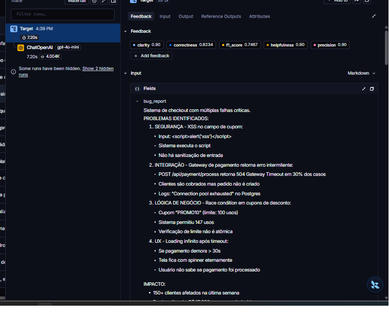

# Pull, Otimização e Avaliação de Prompts com LangChain e LangSmith

Desafio do MBA em Engenharia de IA (Full Cycle). O projeto faz pull de um prompt de baixa
qualidade do LangSmith Prompt Hub, refatora esse prompt com técnicas de Prompt Engineering,
publica a versão otimizada de volta no Hub e a avalia com métricas LLM-as-Judge.

> O enunciado original do desafio está em [`ENUNCIADO.md`](ENUNCIADO.md).
> O histórico completo de iterações está em [`docs/ITERACOES.md`](docs/ITERACOES.md).

## Resultado

✅ **Aprovado na 4ª iteração**, com todas as métricas ≥ 0.8.

| Métrica | Nota | Status |
|---|---|---|
| Helpfulness | 0.873 | ✅ |
| Correctness | 0.8326 | ✅ |
| F1-Score | 0.8025 | ✅ |
| Clarity | 0.8833 | ✅ |
| Precision | 0.8627 | ✅ |
| **Média** | **0.8508** | ✅ |

- **Prompt publicado:** [`alexandre-silva/bug_to_user_story_v2`](https://smith.langchain.com/hub/alexandre-silva/bug_to_user_story_v2)
- **Dataset de avaliação público, com todos os experimentos:** https://smith.langchain.com/public/3fad0631-06c6-4d98-9fe9-429d5a1ce7f8/d

---

## Técnicas Aplicadas (Fase 2)

O prompt otimizado está em [`prompts/bug_to_user_story_v2.yml`](prompts/bug_to_user_story_v2.yml).
Foram aplicadas quatro técnicas, listadas no campo `techniques_applied` do YAML.

### 1. Few-shot Learning (obrigatória)

**Por que:** a tarefa tem um formato de saída muito específico (frase "Como um... eu quero...
para que...", critérios em Gherkin e seções extras que variam com a complexidade do bug).
Descrever esse formato só em palavras deixa margem para interpretação. Exemplos mostram o
padrão diretamente.

**Como foi aplicada:** quatro pares `Entrada:` / `Saída:`, um para cada padrão de resposta:

| Exemplo | Tipo | O que ele ensina ao modelo |
|---|---|---|
| 1 | Simples (busca com acento) | Resposta curta: story + 5 critérios, sem seções extras |
| 2 | Médio, integração (email de redefinição de senha) | Passos de reprodução **não** tornam o bug complexo; HTTP de sucesso, efeitos esperados, log, "Contexto Técnico" |
| 3 | Médio, permissão (cancelar pedido de outro cliente) | "Critérios Adicionais para [perfil]:" e "Contexto de Segurança:" |
| 4 | Complexo (3 falhas numa plataforma de cursos) | Seções `=== ... ===`, um grupo de critérios (A, B, C) por problema, tasks técnicas |

**Todos os exemplos são inventados**, com domínios diferentes dos 15 casos do dataset. Copiar
casos do dataset para o prompt seria *data leakage*: a nota subiria sem provar nada sobre a
qualidade do prompt.

**Achado principal do processo:** few-shot foi a técnica de maior impacto. Nas iterações 2 e
3, mudar apenas instruções moveu o F1 em no máximo +0.014. Na iteração 4, alinhar os exemplos
com as instruções subiu o F1 em +0.026 e a Precision em +0.042. Quando instrução e exemplo
divergem, o modelo (especialmente um modelo pequeno como o `gpt-4o-mini`) segue o exemplo.

### 2. Role Prompting

**Por que:** o v1 dizia apenas "Você é um assistente". Sem persona, o modelo não adota o
vocabulário nem o padrão de qualidade de quem escreve user stories profissionalmente.

**Como foi aplicada:**

```text
Você é um Product Manager sênior com 20 anos de experiência em produtos digitais
(e-commerce, SaaS e mobile), especialista em escrever User Stories no padrão ágil e
critérios de aceitação no formato Gherkin (Dado / Quando / Então).
```

Os domínios citados (e-commerce, SaaS, mobile) são os mesmos do dataset de avaliação.

### 3. Chain of Thought (raciocínio interno)

**Por que:** converter um bug em user story exige análise antes de escrever: identificar a
persona afetada, o comportamento esperado, os fatos concretos do relato e a complexidade.

**Como foi aplicada:** uma seção `PROCESSO DE ANÁLISE` com 6 passos (persona, comportamento
esperado, valor, fatos concretos, complexidade e critérios esperados por tipo de bug).

**Detalhe importante:** a seção instrui o modelo a pensar **mentalmente, sem escrever o
raciocínio na resposta**. O `evaluate.py` envia a resposta inteira para o juiz, e um
raciocínio visível seria avaliado como divagação, derrubando Precision ("foco") e Clarity
("concisão").

### 4. Skeleton of Thought

**Por que:** a análise das 15 respostas de referência mostrou que o formato **cresce com a
complexidade** do bug: cerca de 400 caracteres nos simples, 800 nos médios e de 3.600 a 5.800
nos complexos, com estruturas diferentes.

**Como foi aplicada:** três esqueletos de resposta (`MODELO SIMPLES`, `MODELO MÉDIO` e
`MODELO COMPLEXO`) que reproduzem a ordem e os títulos de seção do gabarito, e um critério
explícito para escolher entre eles:

```text
COMPLEXO: SOMENTE quando o relato descreve 2 ou mais problemas distintos, cada um com causa
e sintoma próprios. Um único problema, mesmo grave, técnico ou de segurança, é MÉDIO.
Passos de reprodução, exemplos, detalhes ou observações em lista NÃO são problemas distintos.
```

### Demais requisitos do prompt

| Requisito | Como foi atendido |
|---|---|
| Instruções claras e específicas | Seções `TAREFA`, `PROCESSO DE ANÁLISE` e `FORMATO DA RESPOSTA` |
| Regras explícitas | 8 regras (ex.: responder só com a story, não inventar dados, não omitir fatos do relato, Gherkin obrigatório) |
| Edge cases | Seção `CASOS ESPECIAIS`: relato vago, vários problemas, segurança, problema sem usuário final, termos em inglês |
| System vs User | System com as instruções fixas; User apenas com `Relato de bug:\n{bug_report}` |

---

## Resultados Finais

### Evidências no LangSmith

- **Dataset público com os 15 exemplos e todos os experimentos:**
  https://smith.langchain.com/public/3fad0631-06c6-4d98-9fe9-429d5a1ce7f8/d
- **Experimento aprovado:** `alexandre-silva-bug_to_user_story_v2-a3853820`

**Experimento aprovado: notas dos 15 exemplos, com as médias no cabeçalho (todas ≥ 0.8):**



**Experimento aprovado: os 15 exemplos do dataset, com input, referência, saída e notas:**



**As 4 iterações comparadas no dataset de avaliação:**



**Tracing detalhado de 3 exemplos (um simples, um médio e um complexo):**





### Evolução das iterações

| Iteração | Mudança principal | F1 | Clarity | Precision | Helpfulness | Correctness | Status |
|---|---|---|---|---|---|---|---|
| 1 | v2 inicial (Role + Few-shot + CoT + Skeleton) | 0.7623 | 0.88 | 0.81 | 0.85 | 0.79 | ❌ |
| 2 | Reparo de texto corrompido no prompt | 0.7623 | 0.8733 | 0.83 | 0.85 | 0.7962 | ❌ |
| 3 | Critério de complexidade, critérios por tipo de bug, regra de não inventar recalibrada | 0.7762 | 0.87 | 0.8207 | 0.8453 | 0.7984 | ❌ |
| 4 | Few-shot alinhado às instruções (dois exemplos médios novos) | **0.8025** | **0.8833** | **0.8627** | **0.873** | **0.8326** | ✅ |

**Método:** cada iteração seguiu o ciclo *medir → ler os comentários do juiz → formular uma
hipótese → mudar → medir de novo*. O diagnóstico vinha do campo `comment` de cada feedback,
que guarda a justificativa do juiz, e não só das médias. Antes de cada avaliação completa,
um teste de fumaça (só geração, sem o juiz) nos casos-problema validou as mudanças a custo
de centavos.

Pontos de destaque da jornada (detalhes em [`docs/ITERACOES.md`](docs/ITERACOES.md)):

- **Iteração 1:** o F1 caiu por **recall**, não por erro. O juiz quase nunca apontou
  informação errada; a crítica recorrente era a omissão de critérios que um PM experiente
  incluiria (acessibilidade, log de auditoria, e-mail de confirmação). A regra contra
  alucinação estava calibrada de forma conservadora demais.
- **Iteração 2:** a leitura linha a linha revelou que o prompt avaliado tinha 8 trechos
  corrompidos por copiar e colar, incluindo o passo que definia a complexidade. O reparo foi
  avaliado **isoladamente** e não mudou o F1, o que descartou essa hipótese. Lição:
  validação estrutural (YAML válido, seções presentes) não detecta texto corrompido.
- **Iteração 3:** as instruções novas tiveram pouco efeito porque **os exemplos não as
  demonstravam**. O modelo seguia os exemplos.
- **Iteração 4:** com exemplos alinhados às instruções, todas as métricas passaram.

**Limitações conhecidas:**

- A margem do F1 é pequena (0.8025). Como o juiz é um LLM, há variância entre execuções, e o
  mesmo prompt pode oscilar em torno do limite.
- O bug de segurança do endpoint `/api/users/:id` ainda sai no formato complexo, embora com o
  conteúdo correto (os dois perfis e os dados expostos).

### Comparação v1 × v2

| Aspecto | v1 (original) | v2 (otimizado) | Por quê |
|---|---|---|---|
| Persona | "um assistente" | Product Manager sênior especialista em Gherkin | Ativa o vocabulário e o padrão de qualidade certos |
| `{bug_report}` | Duplicado no system **e** no user | Apenas no user prompt | Separa instrução de dado; o modelo recebia o bug duas vezes |
| Formato da saída | Nenhum ("crie uma user story") | 3 esqueletos por complexidade, iguais ao gabarito | Saída previsível, que o juiz avalia como organizada |
| Exemplos | Nenhum | 4 exemplos próprios, um por padrão de resposta | Mostra ao modelo como é uma resposta boa |
| Raciocínio | Nenhum | Análise interna em 6 passos, sem exibir | Persona, fatos e complexidade identificados antes de escrever |
| Regras | Nenhuma | 8 regras explícitas | Controla alucinação, omissão, formato e tamanho |
| Edge cases | Nenhum | 5 casos especiais | Todos existem no dataset (segurança, vários problemas, termos em inglês...) |
| Tamanho do system prompt | ~230 caracteres | ~12.000 caracteres | Instruções, esqueletos e exemplos |

O `evaluate.py` avalia apenas o prompt v2, por isso o v1 não tem notas próprias neste
projeto. A comparação acima é qualitativa, baseada nos defeitos identificados no v1.

---

## Como Executar

### Pré-requisitos

- **Python 3.10+.** O projeto foi testado com **Python 3.12**. Em ambientes com Python mais
  novo que ainda não tenham wheels de alguma dependência, use o [uv](https://docs.astral.sh/uv/)
  para criar o ambiente com 3.12 (ver abaixo).
- Conta no [LangSmith](https://smith.langchain.com) com uma API Key
- API Key da [OpenAI](https://platform.openai.com/api-keys) ou do
  [Google AI Studio](https://aistudio.google.com/app/apikey)

### 1. Ambiente virtual e dependências

Com `venv` padrão:

```bash
python3 -m venv venv
source venv/bin/activate        # Windows: venv\Scripts\activate
pip install -r requirements.txt
```

Ou com `uv`, fixando o Python 3.12:

```bash
curl -LsSf https://astral.sh/uv/install.sh | sh
uv venv venv --python 3.12
source venv/bin/activate
uv pip install -r requirements.txt
```

### 2. Variáveis de ambiente

```bash
cp .env.example .env
```

Preencha o `.env`:

| Variável | Valor usado neste projeto |
|---|---|
| `LANGSMITH_API_KEY` | sua chave do LangSmith |
| `LANGSMITH_PROJECT` | `mba-bug-to-user-story` (o dataset fica `mba-bug-to-user-story-eval`) |
| `USERNAME_LANGSMITH_HUB` | seu handle do Hub (ver abaixo) |
| `LLM_PROVIDER` | `openai` |
| `OPENAI_API_KEY` | sua chave da OpenAI |
| `LLM_MODEL` | `gpt-4o-mini` (gera as respostas) |
| `EVAL_MODEL` | `gpt-4o` (julga as respostas) |

O modelo avaliador é mais capaz que o gerador de propósito: avaliar é mais difícil que gerar,
e um juiz diferente do gerador reduz o viés de autoavaliação.

### 3. Handle do LangSmith Hub

O handle só existe depois de criado, e é **definitivo**. Pela interface, ele é definido ao
tornar um prompt público pela primeira vez. Se a opção não aparecer, é possível criá-lo pela
API ([`POST /api/v1/settings/handle`](https://docs.langchain.com/langsmith/smith-api/settings/set-tenant-handle.md)):

```bash
source .env
curl -X POST https://api.smith.langchain.com/api/v1/settings/handle \
  -H "X-API-Key: $LANGSMITH_API_KEY" -H "Content-Type: application/json" \
  -d '{"tenant_handle": "seu-handle"}'
```

### 4. Fases do projeto

Todos os comandos são executados na raiz do projeto, com o ambiente virtual ativo.

```bash
# Fase 1: pull do prompt original (salva prompts/bug_to_user_story_v1.yml)
python src/pull_prompts.py

# Fase 2: o prompt otimizado já está em prompts/bug_to_user_story_v2.yml

# Fase 3: push do prompt otimizado para o Hub (público, com tags, descrição e técnicas)
python src/push_prompts.py

# Fase 4: avaliação (cria um experimento no LangSmith e grava as 5 notas como feedback)
python src/evaluate.py

# Testes de validação do prompt
pytest tests/test_prompts.py -v
```

**Ciclo de iteração:** editar o `v2.yml` → `push_prompts.py` → `evaluate.py`. O `evaluate.py`
lê o prompt do **Hub**, não do arquivo local, então avaliar sem fazer push avalia a versão
anterior. Fazer push de um prompt sem alterações retorna `409 Nothing to commit`, que não é
um erro do script.

### Testes

`tests/test_prompts.py` contém os 6 testes pedidos no enunciado e 2 testes extras:

| Teste | O que verifica |
|---|---|
| `test_prompt_has_system_prompt` | O system prompt existe e não está vazio |
| `test_prompt_has_role_definition` | Há uma persona ("Você é um Product Manager") |
| `test_prompt_mentions_format` | Exige User Story padrão, critérios de aceitação e Gherkin |
| `test_prompt_has_few_shot_examples` | Pelo menos 2 exemplos, com o mesmo número de entradas e saídas |
| `test_prompt_no_todos` | Nenhum TODO no arquivo, inclusive em comentários |
| `test_minimum_techniques` | Pelo menos 2 técnicas em `techniques_applied` |
| `test_prompt_structure_is_valid` *(extra)* | Passa no validador do projeto (`utils.validate_prompt_structure`) |
| `test_only_bug_report_variable` *(extra)* | `{bug_report}` é a única variável e não aparece no system prompt |

---

## Decisões técnicas

- **Fork sincronizado com o repositório oficial.** Durante o desenvolvimento, o repositório
  base foi atualizado para LangChain 1.x, com um `evaluate.py` que cria experimentos no
  LangSmith. O fork foi sincronizado por merge, e os scripts de pull e push foram migrados
  de `langchain.hub` para o `Client` do `langsmith`.
- **`dangerously_pull_public_prompt=True` no pull.** Um prompt do Hub é um objeto LangChain
  serializado, e desserializar objetos de terceiros é um risco conhecido. O LangSmith bloqueia
  esse pull por padrão; a flag é usada apenas para o prompt semente do desafio.
- **Validação antes do push.** O `push_prompts.py` reaproveita `validate_prompt_structure` e
  verifica também se o `user_prompt` contém `{bug_report}`. Sem essa variável, todas as notas
  viriam baixas sem nenhum erro aparente.
- **Arquivos de avaliação intocados.** `evaluate.py`, `metrics.py`, `utils.py` e o dataset não
  foram alterados. Todo o ganho de nota veio do prompt.

## Estrutura do projeto

```
├── datasets/bug_to_user_story.jsonl   # 15 bugs com respostas de referência (não alterado)
├── docs/ITERACOES.md                  # histórico detalhado das 4 iterações
├── prompts/
│   ├── bug_to_user_story_v1.yml       # prompt original (pull do Hub)
│   └── bug_to_user_story_v2.yml       # prompt otimizado
├── screenshots/                       # evidências do LangSmith
├── src/
│   ├── pull_prompts.py                # pull do prompt original
│   ├── push_prompts.py                # validação e push do prompt otimizado
│   ├── evaluate.py                    # avaliação (fornecido)
│   ├── metrics.py                     # métricas LLM-as-Judge (fornecido)
│   └── utils.py                       # funções auxiliares (fornecido)
├── tests/test_prompts.py              # testes de validação do prompt
├── ENUNCIADO.md                       # enunciado do desafio
└── README.md
```
